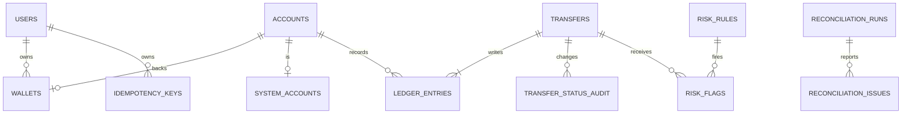

# Payments-Grade Wallet Ledger

PostgreSQL 15 + FastAPI implementation of a double-entry wallet. Start everything with `docker compose up --build`; the API is at `http://localhost:8000`.

## Design decisions

- Money is integer paise in `BIGINT`; entry amounts are positive and direction is separate.
- `accounts` unifies user wallets and system accounts because every movement then has the same ledger and locking path. `wallets` and `system_accounts` provide ownership and stable names.
- Stored balances are maintained for fast reads and checked nightly against ledger-derived balances. This costs write work and requires reconciliation, but avoids scanning entries on every balance request.
- Email and phone are user-controlled identifiers, so they are unique alternate keys rather than primary keys. IDs are generated BIGINTs.
- A transfer uses Read Committed plus `SELECT ... FOR UPDATE` on all accounts in ascending `account_id` order. The balance is reread under lock, ledger entries and balance updates commit atomically, and wallets cannot become negative. Serializable would detect more conflicts but adds aborts and client retries without improving this locked path.
- Ledger rows are append-only through a database trigger. Corrections use reversal transfers.
- Idempotency is per user and stores a SHA-256 body hash and exact response JSON. A running duplicate gets 409; a completed duplicate replays the saved result.

## Nouns and tables

Users, wallets, accounts, system accounts, transfers, ledger entries, idempotency keys, transfer status audit, risk rules, risk flags, reconciliation runs, reconciliation issues, and job locks all store identity or state and therefore become tables. Currency, direction, status, KYC state, and transfer type are controlled domains and become enums. A balance is an account attribute because it is a cache of ledger entries. A request and a question are transient inputs, not tables.

## Cardinalities

A user has many wallets; each wallet belongs to one user. Each wallet has one account; each account belongs to at most one wallet or system account. A transfer has two or more ledger entries; each entry belongs to one account and one transfer. A user has many idempotency keys. A transfer has many audit rows and risk flags. A reconciliation run has many issues. One job lock represents one named scheduled job.

## ER diagram

## Reconciliation

The nightly transaction should run the checks in `POST /admin/reconciliation/run` at Repeatable Read while holding `job_locks.reconciliation` with `FOR UPDATE NOWAIT`. Global and per-transfer totals can scan the ledger during the nightly window. Account and transfer indexes support the grouped joins; statement reads use `(account_id, created_at DESC, id DESC)`. Offset pagination becomes slower at large offsets because PostgreSQL still walks and discards preceding rows; a `(created_at,id)` cursor is the next optimization.

## Testing and next steps

The intended CI command is `pytest`. Add a Postgres-backed stampede fixture that seeds 500 paise and issues 100 concurrent 10-paise transfers, plus idempotency and corruption fixtures. The risk rules are stored in `risk_rules`; production would inject an LLM adapter only for explanations and JSON intent parsing, never authorization or SQL generation.
